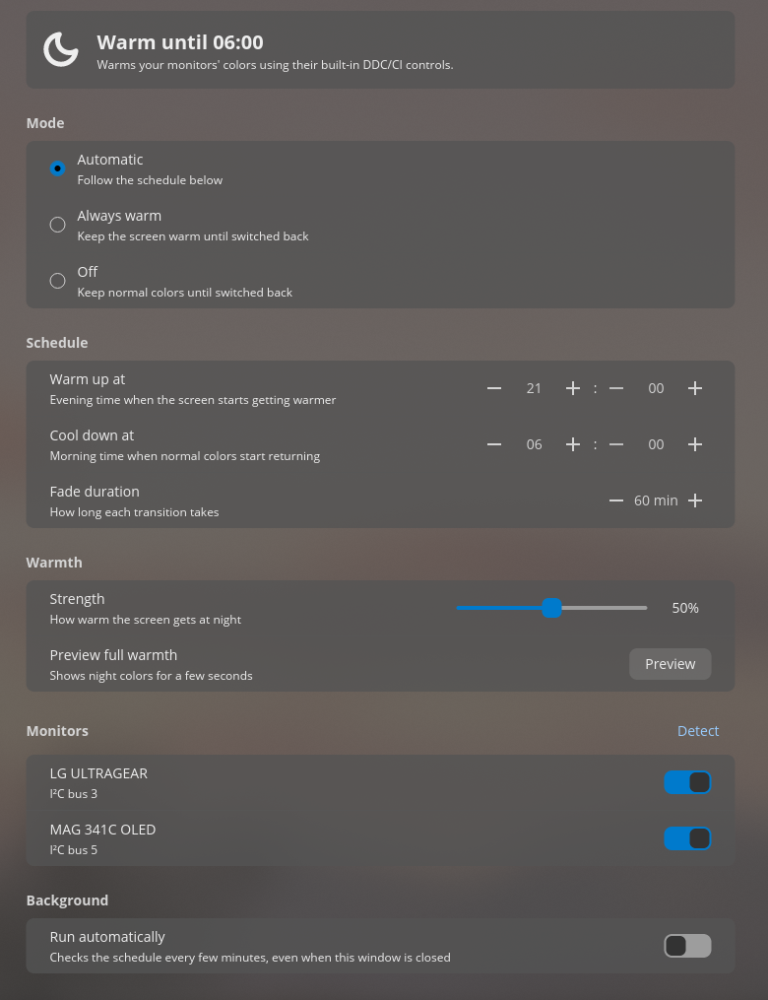

# Ember

**A night light for the COSMIC desktop.** Ember warms your screen's colors in the evening so it's easier on the eyes, then brings them back to normal in the morning. It follows a fixed schedule or the actual sunset and sunrise where you live.

<p align="center">
  
</p>

## Why this exists

COSMIC doesn't have a night light yet. The usual Linux tools (Redshift, gammastep, wlsunset) don't work on it either, because COSMIC doesn't let other apps change the screen's colors.

Ember gets around that by talking to the **monitors themselves**. Most external monitors accept color commands over the display cable, a standard called DDC/CI. Ember uses that to lower each monitor's blue and green levels at night, and then restores its normal color preset in the morning.

## What you get

**A settings app.** Open "Ember" from your app launcher to change:

- **Mode**: follow the schedule, stay warm, or stay off.
- **Schedule**: pick one of two:
  - **Fixed times**, for example warm from 21:00 and back to normal at 06:00.
  - **Sunset to sunrise**, which follows the sun where you live. Your location is estimated from your time zone, with no internet needed, or you can type in your exact coordinates.
- **Fade duration**: the change happens gradually over up to three hours, so you won't notice it.
- **Warmth**: how warm the screen gets. When you let go of the slider it shows you full warmth for a few seconds.
- **Monitors**: which screens to control.
- **Run automatically**: keep the schedule running in the background, even when the window is closed.

**A panel icon.** A moon while the screen is warm, a sun when it isn't. Click it to switch modes or open the settings.

<p align="center">
  
</p>

**A command-line tool** for scripts and quick changes:

```
ember night       # warm now, until you switch back
ember day         # normal colors, until you switch back
ember auto        # follow the schedule again
ember status      # what it's doing right now
ember times       # today's fade times
```

Times always follow your computer's clock, so daylight saving time is handled automatically.

## Will it work for me?

You need:

- The **COSMIC** desktop (made for Pop!_OS 24.04, but any COSMIC setup should work).
- **External monitors with DDC/CI** turned on. Most monitors support it, but some ship with it off in the on-screen menu. Laptop screens don't support it.
- Monitors with a **"User" color mode** whose red/green/blue levels can be adjusted. Most monitors have one.

To check your monitors, install `ddcutil` and run `ddcutil detect`. Each monitor it lists should work.

## Installing

1. Install the tools Ember needs, and give yourself access to the monitor connection:

   ```
   sudo apt install ddcutil just
   sudo usermod -aG i2c $USER
   ```

   Then log out and back in so the group change takes effect.

2. Build and install. Everything goes into your home folder, so no `sudo` is needed:

   ```
   just install
   ```

   Building needs the Rust toolchain ([rustup.rs](https://rustup.rs)).

3. Open **Ember** from the app launcher, click **Detect** under Monitors, and turn on **Run automatically**.

4. To add the panel icon, open **Settings → Desktop → Panel → Configure panel applets**, click **Add applet**, and pick **Ember**. If it isn't in the list, log out and back in.

## Uninstalling

First remove the panel icon in **Settings → Desktop → Panel**. Then run:

```
just uninstall
```

This stops the background schedule, puts your monitors back to normal colors, and removes the installed files. Your settings stay in `~/.config/ember/`, so delete that folder too if you want everything gone.

If a monitor stays warm afterwards, pick its standard or 6500 K color preset in its on-screen menu.

## Good to know

- **Each monitor's own menu will show a "User" color mode at night.** That's Ember at work. Switching presets in the monitor menu will override it until the next change.
- **Changes aren't instant.** Talking to monitors over the cable takes about a second per monitor. Fades happen in small steps a few minutes apart.
- **Far north or south, the sun sometimes doesn't set.** On those days Ember falls back to your fixed times and says so in the app.
- **Some monitors misreport their state.** For example, the MSI MAG 341C OLED reports the wrong color preset back, but it does apply the change. If a monitor ignores the change, try `ember night` again, or untick it under Monitors.

## For developers

The project has three parts that share one config file (`~/.config/ember/config.json`):

| Part | Written in | Role |
|---|---|---|
| `cli/ember` | Python | Does the actual monitor control (via `ddcutil`), the schedule and sunrise/sunset math, and the background timer. |
| `cosmic-ember` | Rust, [libcosmic](https://github.com/pop-os/libcosmic) | The settings app. |
| `cosmic-applet-ember` | Rust, libcosmic | The panel icon and popup. |

The CLI is the single source of truth. The GUIs save settings, ask the CLI to apply them, and show what `ember status --json` reports. They never talk to the monitors or compute the schedule themselves.

```
src/
  config.rs        settings: load, save, defaults
  status.rs        what the CLI reports, plus status text and sun/moon icon
  backend.rs       runs the CLI and checks the background timer
  clock.rs         "HH:MM" times
  paths.rs         where files live
  bin/app/         settings window (app.rs, view.rs, location.rs, time_picker.rs)
  bin/applet/      panel icon and popup
cli/ember          command-line tool
res/               app launcher entries
```

Useful commands:

```
just test          # run the tests
just check         # lint with clippy
just install       # build and install for your user
```

## License

Public domain, under [The Unlicense](LICENSE). Do whatever you like with it.

Ember is built on [libcosmic](https://github.com/pop-os/libcosmic), which has its own license (MPL-2.0).
